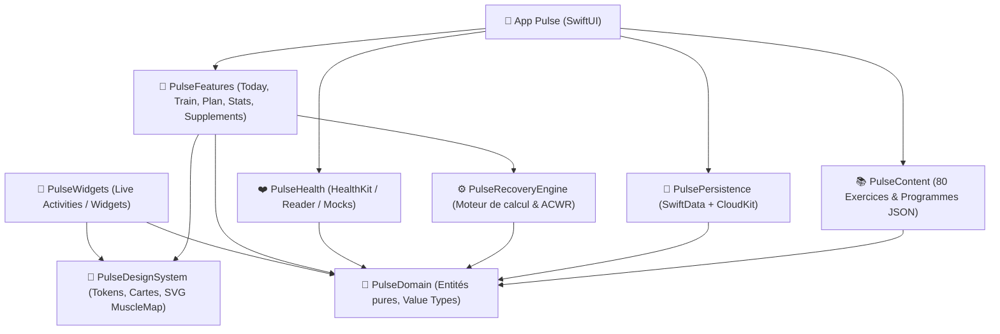

<p align="center">
  
</p>

<h1 align="center">Pulse</h1>

<p align="center">
  <strong>L'application iOS native pour les athlètes hybrides musculation & course à pied.</strong><br>
  Adapte automatiquement la séance du jour à la récupération physiologique réelle mesurée par Apple Santé (HealthKit).
</p>

<p align="center">
  
  
  
  
  
  
  
</p>

---

## 📑 Sommaire

- [1. Intention & Philosophie](#1-intention--philosophie)
- [2. Les 3 Moments Clés](#2-les-3-moments-clés)
- [3. Moteur Physiologique (PulseRecoveryEngine)](#3-moteur-physiologique-pulserecoveryengine)
- [4. Architecture Technique & Modularisation](#4-architecture-technique--modularisation)
- [5. Arborescence du Projet](#5-arborescence-du-projet)
- [6. Feuille de Route & Avancement (M1 → M8)](#6-feuille-de-route--avancement-m1--m8)
- [7. Démarrage Rapide & Développement](#7-démarrage-rapide--développement)
- [8. Tests & Qualité](#8-tests--qualité)
- [9. Confidentialité & Données Santé](#9-confidentialité--données-santé)
- [10. Crédits & Licence](#10-crédits--licence)

---

## 1. Intention & Philosophie

Les pratiquants qui combinent la musculation intensive (programmes Push/Pull/Legs, Haut/Bas, Full Body) et la course à pied font face à un vide d'outillage majeur :
- **Hevy et Strong** ignorent totalement la biométrie et imposent un volume figé.
- **Whoop et Oura** mesurent la récupération mais ne proposent aucun carnet d'entraînement en musculation.
- **Fitbod** tente de deviner la fatigue musculaire sans exploiter les données physiologiques réelles.

**Pulse** fait le pont entre ces mondes : l'application lit les biométries nocturnes issues d'Apple Santé (provenant par exemple d'une Apple Watch ou d'une montre Fitbit synchronisée), calcule un score de récupération scientifiquement éprouvé, et ajuste concrètement la séance de musculation prévue (volume, plafond de RPE, temps de repos, charges).

### Principes Directeurs
- **Transparence totale** : Aucun score magique. L'écran *« Pourquoi ? »* détaille chaque pondération et explicite chaque modification suggérée.
- **Souveraineté de l'athlète** : Une adaptation n'est jamais imposée. L'utilisateur peut à tout instant rétablir la *« Séance d'origine »* en un geste.
- **100% Hors-ligne & Zéro Télémétrie** : Vos données de santé restent sur votre appareil et dans votre conteneur privé iCloud. Aucun serveur tiers, aucun tracker d'analytics.
- **Performance & Clarté** : Saisie d'une série en moins de 4 secondes, interface OLED à contraste élevé, clavier numérique dédié, chrono en Live Activity & Dynamic Island.

---

## 2. Les 3 Moments Clés


### 🌅 1. Le Matin (Avant l'entraînement)
- Lecture automatique de la nuit : Variabilité de la Fréquence Cardiaque (VFC / SDNN), Fréquence Cardiaque au repos (FCR) et stades de sommeil (profond, paradoxal / REM).
- Calcul du score de récupération (0 à 100) et classement en 4 états :
  - **Optimal (90–100)** : Pleine forme, surcharge progressive encouragée (+1 répétition ou charge).
  - **Normal (65–89)** : Séance standard conforme à la programmation.
  - **Fatigue modérée (40–64)** : Séance allégée (suppression de la dernière série des exercices d'assistance, RPE max 8, repos prolongé de 30 s).
  - **Surentraînement (< 40)** : Proposition de jour de repos actif ou routine de mobilité douce.
- Mode **Check-in subjectif** : Si moins de deux métriques biométriques sont disponibles, un formulaire rapide (qualité du sommeil, courbatures, motivation) produit un score estimé.

### 🏋️‍♂️ 2. Pendant la Séance (Le Carnet Live)
- Saisie à une main ultra-rapide avec clavier numérique personnalisé intégré.
- Chrono de repos automatisé visible dans la **Dynamic Island** et sur l'écran verrouillé (**Live Activity**).
- Calculateur de disques de fonte instantané selon le matériel déclaré.
- Remplacement d'exercices intelligent (machine occupée, gêne ou douleur) conservant le même plan de mouvement et adaptant la charge équivalente.
- Persistance immédiate : aucune donnée perdue en cas d'extinction inattendue ou de fermeture d'app (bandeau *« Reprendre la séance »*).

### 🌙 3. Après la Séance & Suivi Continu
- Récapitulatif : tonnage total, volume par groupe musculaire sur carte 2D face/dos, estimation du 1RM (formule Brzycki).
- Gestionnaire de compléments (créatine, oméga-3, whey, etc.) : suivi des prises par moment de la journée, suivi du stock restant et rappels locaux.
- **Jauge ACWR** (*Acute:Chronic Workload Ratio*) : ratio de charge aiguë (7 jours) sur charge chronique (28 jours) pour prévenir les blessures (zone optimale entre 0.8 et 1.3).
- **Règles anti-interférence** : prévention des conflits biomécaniques entre les séances lourdes pour les jambes et les sorties de course à pied intenses ou longues.

---

## 3. Moteur Physiologique (`PulseRecoveryEngine`)

Le moteur de calcul est un package Swift pur, déterministe et entièrement testable sans environnement d'exécution complexe.

### Formule du Score Physiologique
Le score global pondère trois piliers dès lors qu'ils sont disponibles :

$$\text{Score} = 0.50 \times \text{Score}_{\text{VFC}} + 0.25 \times \text{Score}_{\text{Sommeil}} + 0.25 \times \text{Score}_{\text{FCR}}$$

- **VFC ($\text{SDNN}$)** : Traitée sous transformation logarithmique naturelle $\ln(\text{SDNN})$ pour normaliser sa distribution. Comparée à la ligne de base mobile de l'utilisateur (médiane et écart-type sur 60 jours, minimum 5 nuits). Un $z\text{-score} \ge 0.5$ donne 100/100 ; un $z\text{-score} \le -3.5$ donne 10/100.
- **Sommeil** : Combine la durée totale par rapport au besoin de référence (70%) et la qualité des stades profond + REM (30%).
- **Fréquence cardiaque au repos (FCR)** : Comparée à la médiane sur 60 jours. Une augmentation anormale au-delà de la ligne de base pénalise rapidement le score (chute à 0 si élévation $\ge 12\text{ bpm}$).
- **Renormalisation dynamique** : Si un seul facteur manque (ex. pas de VFC cette nuit-là), les poids restants sont recalculés proportionnellement (50% / 50%).

---

## 4. Architecture Technique & Modularisation

Le projet applique une séparation stricte des responsabilités. Le cœur métier et le moteur d'adaptation ne dépendent d'aucun framework d'UI ou de stockage externe.



| Module / Package | Rôle & Dépendances |
| :--- | :--- |
| **`PulseDomain`** | Définitions pures (aucun import Apple sauf `Foundation`). Entités : `NightSample`, `Factor`, `RecoveryCategory`, `TimedSample`. |
| **`PulseRecoveryEngine`** | Algorithmes physiologiques purs, calculs ACWR, scénarios de charge, ajustements de volume. Testé sur fixtures JSON. |
| **`PulseHealth`** | Abstraction d'Apple Santé via le protocole `HealthReading`. Fournit `HealthKitReader` (production) et `StubHealthReader` (développement & tests). |
| **`PulsePersistence`** | Modèles SwiftData, synchronisation CloudKit privée, export de données (JSON / CSV), purge complète. |
| **`PulseContent`** | 80 exercices et 4 programmes types intégrés au bundle en JSON statique bilingue (FR/EN) avec versionnage stable. |
| **`PulseDesignSystem`** | Système de design natif : thèmes noir profond et ambre/opale, cartes verre obsidienne, silhouettes musculaires vectorielles SVG 2D. |
| **`PulseFeatures`** | Écrans SwiftUI modulaires assemblés par onglets : *Aujourd'hui*, *Entraîner*, *Planning*, *Statistiques*, *Profil*. |
| **`Pulse` (App)** | Point d'entrée de l'application, injection de dépendances racine (`AppDependencies`), navigation. |

---

## 5. Arborescence du Projet

```text
fitness/
├── Makefile                          # Commandes standardisées de test et lint
├── .swiftlint.yml                    # Règles strictes SwiftLint
├── Pulse.xcodeproj                   # Projet principal Xcode
├── Pulse/                            # Cœur de l'application iOS
│   ├── PulseApp.swift                # Point d'entrée (@main)
│   ├── AppDependencies.swift         # Composition root & injection de dépendances
│   ├── Diagnostics/                  # Écran de diagnostic HealthKit & état initial
│   └── Assets.xcassets/              # Ressources graphiques & icône d'app
├── Packages/
│   ├── PulseDomain/                  # Entités et règles métier pures
│   ├── PulseRecoveryEngine/          # Moteur de score, ACWR, fixtures de test
│   └── PulseHealth/                  # Abstraction et implémentation HealthKit
├── PulseTests/                       # Tests d'intégration et modèles d'application
├── docs/
│   └── superpowers/
│       ├── specs/                    # Spécifications de conception (V1, M2...)
│       └── plans/                    # Plans d'implémentation détaillés par jalon
├── ci_scripts/
│   └── ci_post_clone.sh              # Script de configuration pour Xcode Cloud
└── assets/                           # Maquettes et vecteurs graphiques
```

---

## 6. Feuille de Route & Avancement (M1 → M8)

Le développement est segmenté en 8 jalons autonomes livrant chacun un sous-ensemble fonctionnel et vérifiable :

| Jalon | Intitulé | Statut | Description & Livrables |
| :---: | :--- | :---: | :--- |
| **M1** | **Fondations et Moteur** | ✅ Terminé | Architecture packages, moteur physiologique complet, lecture HealthKit, agrégateur nocturne, écran diagnostics, CI Xcode Cloud. |
| **M2** | **Données et Contenu** | 🚧 En cours | Persistance SwiftData + CloudKit, package `PulseContent` (80 exercices + 4 programmes types en JSON), export et suppression RGPD. |
| **M3** | **Onboarding & Tableau de bord** | ⏳ Prévu | Onboarding 6 écrans, accueil Today avec jauge ambrée, carte Pourquoi, check-in, widget de récupération. |
| **M4** | **Programmes & Séance Live** | ⏳ Prévu | Carnet live, clavier numérique grand format, chrono en Live Activity / Dynamic Island, calculateur de disques, 1RM. |
| **M5** | **Compléments** | ⏳ Prévu | Suivi des prises par moment, alertes de stock, synchronisation HealthKit, notification interactive « Pris ». |
| **M6** | **Planning & Anti-interférence** | ⏳ Prévu | Calendrier mensuel, import des courses Apple Santé, détection et résolution des conflits jambes / course à pied, décharge ACWR. |
| **M7** | **Statistiques & Profil** | ⏳ Prévu | Cartes thermiques musculaires, charge cumulée, records personnels, lissage du poids corporel. |
| **M8** | **App Store & Polissage** | ⏳ Prévu | Audit accessibilité (VoiceOver, Dynamic Type), conformité vie privée, captures d'écran, soumission TestFlight et App Store. |

---

## 7. Démarrage Rapide & Développement

### Prérequis
- **macOS** avec **Xcode 26+** installé.
- **Swift 6** activé.
- [SwiftLint](https://github.com/realm/SwiftLint) pour la vérification du style de code :
  ```bash
  brew install swiftlint
  ```

### Installation
1. Clonez le dépôt :
   ```bash
   git clone https://github.com/D-Seonay/fitness.git
   cd fitness
   ```
2. Ouvrez le projet dans Xcode :
   ```bash
   open Pulse.xcodeproj
   ```

### Commandes Utiles (`Makefile`)

Le projet inclut un `Makefile` à la racine pour automatiser les tâches régulières :

```bash
# Lancer l'ensemble des validations (lint + tests packages + tests app)
make test

# Lancer uniquement les tests unitaires ultra-rapides des packages Swift (sans simulateur)
make test-packages

# Lancer les tests de l'application sur le simulateur iPhone
make test-app

# Vérifier la conformité du code avec SwiftLint en mode strict
make lint
```

### Développement sans Apple Watch ni Montre Connectée
Pour tester le comportement de l'application sur simulateur ou sans capteur réel, `AppDependencies.preview()` et `StubHealthReader` injectent des profils de données pré-enregistrés :
- `typicalNight` (nuit complète, récupération optimale).
- `outOfRangeSDNN` (valeurs atypiques).
- Scénarios de tests disponibles dans `PulseRecoveryEngine/Tests/.../Fixtures/`.

---

## 8. Tests & Qualité

Pulse applique les plus hauts standards de rigueur logicielle :
- **Swift Testing (`import Testing`)** : Utilisation exclusive du nouveau framework de test natif Swift (`@Test`, `@Suite`, tests paramétrés `#expect`).
- **Fixtures Physiologiques** : Le moteur est validé contre des jeux de données réels sérialisés au format JSON (`bonne-nuit.json`, `mauvaise-nuit.json`, `vfc-manquante.json`, `huit-nuits.json`, etc.).
- **Intégration Continue (CI)** : À chaque push, **Xcode Cloud** exécute le script `ci_scripts/ci_post_clone.sh`, installe SwiftLint, exécute `make test` et assure la non-régression avant tout déploiement TestFlight.

---

## 9. Confidentialité & Données Santé

- **Local-First** : Pulse est conçu pour être utilisable à 100% sans connexion réseau.
- **Zéro Serveur / Zéro Tiers** : Aucune donnée biométrique ne transite sur des serveurs privés ou des plateformes tierces d'analytics.
- **Sauvegarde Chiffrée** : Si iCloud est activé, la synchronisation s'effectue exclusivement dans le conteneur CloudKit privé de l'utilisateur, inaccessible aux tiers et aux créateurs de l'application.
- **Droit à l'oubli** : Un bouton de purge totale permet d'effacer immédiatement l'intégralité des données locales et synchronisées en conformité avec le RGPD.

> [!NOTE]  
> **Avertissement de non-dispositif médical :** Pulse est un outil d'assistance à la planification sportive et de bien-être physique. Il ne constitue pas un dispositif médical et ne fournit aucun diagnostic, traitement ou conseil de posologie médicamenteuse.

---

## 10. Crédits & Licence

- **Conception et Développement** : Mathéo Delaunay.
- **Cartographie Musculaire** : Silhouettes vectorielles adaptées de [MuscleMap](https://github.com/musclemap) (Licence MIT).
- **Environnement de développement** : Conçu avec [T3 Code](https://t3.codes).

*Projet sous licence propriétaire — Tous droits réservés.*
